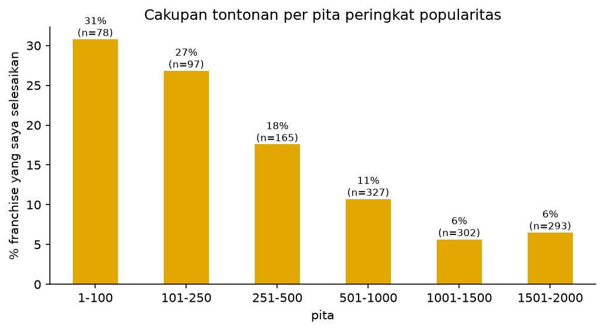
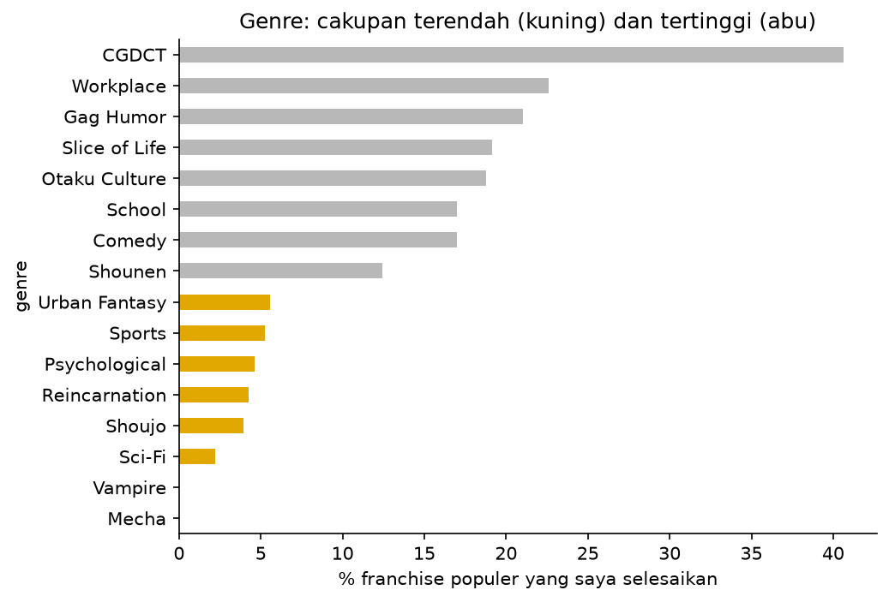
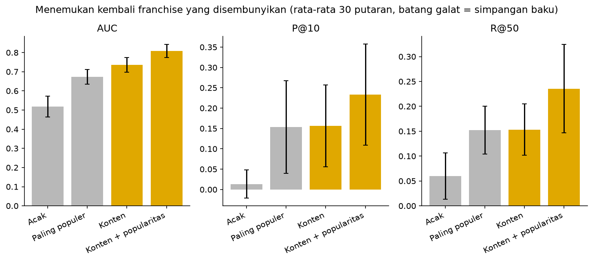
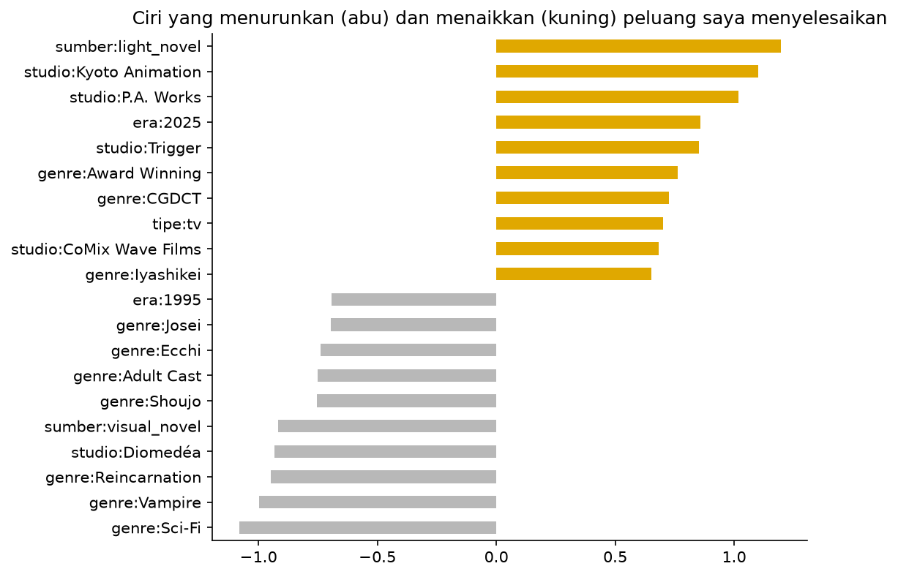

# Anma: analisis dan rekomendasi anime

Proyek analisis data dari awal sampai akhir: mengambil data lewat API, membersihkan data yang berantakan, menulis query SQL, menganalisis pola tontonan, dan membangun model rekomendasi dengan evaluasi yang jujur.

**Pertanyaan:** dari anime populer yang belum saya tonton, mana yang paling mungkin cocok, dan bagaimana pola tontonan saya dibanding katalog MyAnimeList (MAL) secara keseluruhan?

**Batasan utama:** saya tidak memberi rating pada list saya. Status "selesai" dipakai sebagai sinyal suka tersirat (implicit feedback), sedangkan "belum ditonton" tidak berarti "tidak suka".

## Data

- **List pribadi:** 323 entri (anime), dikelompokkan menjadi 214 franchise karena sequel, season, OVA, dan spin-off pendek dihitung terpisah di MAL.
- **Katalog populer:** 2.000 judul teratas menurut popularitas MAL (1.262 franchise), dengan atribut: genre, studio, sumber cerita, tipe, tahun, skor komunitas, dan jumlah pengguna.
- **Sumber:** API resmi MyAnimeList. Data mentah tidak disertakan di repositori ini (lihat bagian Atribusi).

## Metode

1. **Pengumpulan dan pengelompokan franchise** (`ambil_data.py`): hubungan antar judul (sequel, prequel, side story, dan seterusnya) dipakai untuk menggabungkan judul menjadi franchise lewat connected components.
2. **SQL** (`muat_sqlite.py`, `queries.sql`): data dimuat ke SQLite, lalu dianalisis dengan `JOIN`, `GROUP BY`, `CASE`, `LEFT JOIN`, dan CTE.
3. **Pembersihan dan analisis** (`anma_analisis.ipynb`): menangani nilai kosong, menandai judul panjang atau masih tayang (mis. One Piece), dan menghitung cakupan per franchise.
4. **Model dan evaluasi** (`anma_model.ipynb`): regresi logistik pada ciri konten (genre, studio, sumber cerita, era, tipe) dengan dan tanpa popularitas. Evaluasi dengan menyembunyikan 20% franchise yang sudah saya selesaikan (satu franchise utuh sekaligus, untuk menghindari kebocoran data), diulang 30 kali, dibandingkan dengan pembanding acak dan "paling populer".

## Hasil

### Pola tontonan

- 22% entri list saya berada di luar 2.000 judul populer. Median peringkat popularitas judul saya: 766.
- Dari franchise populer, 150 dari 1.262 (12%) sudah saya selesaikan. Di 250 teratas: 50 dari 175 (29%).
- Cakupan menurun seiring peringkat popularitas, dari 31% (peringkat 1 sampai 100) menjadi 6% (peringkat 1001 sampai 2000).



- Genre dengan cakupan terendah: Mecha, Vampire, dan Sci-Fi. Cakupan tertinggi: CGDCT.



### Model rekomendasi

Menemukan kembali franchise yang disembunyikan (rata-rata 30 putaran):

| Metode | AUC | P@10 | R@50 |
|---|---|---|---|
| Acak | 0,52 | 0,01 | 0,06 |
| Paling populer | 0,67 | 0,15 | 0,15 |
| Konten | 0,74 | 0,16 | 0,15 |
| Konten + popularitas | **0,81** | 0,23 | 0,24 |



AUC adalah peluang bahwa franchise yang disembunyikan mendapat skor lebih tinggi daripada franchise acak (0,5 = menebak). Pada P@10 dan R@50, batang galat antar metode saling tumpang tindih, jadi pegangan utama adalah AUC.

Ciri yang paling menaikkan peluang saya menyelesaikan sebuah franchise: light novel, Kyoto Animation, P.A. Works, CGDCT, Iyashikei. Yang paling menurunkan: Sci-Fi, Vampire, Reincarnation.



Contoh rekomendasi teratas: Violet Evergarden, Dr. Stone, Jujutsu Kaisen, Mob Psycho 100, Nichijou.

### Temuan

- Mencari model berdasarkan jenis pemilihan franchise, ada franchise yang saya tonton disembunyikan dan model diminta mencari franchise yang dimaksud. Hasilnya Konten + popularitas (maksud dari konten adalah ciri konten (genre, studio, sumber cerita, era)) memiliki nilai 0.81 yang artinya performanya baik. Sebenarnya konten saja sudah memiliki nilai yang cukup baik (0.74). Hal ini menandakan konten anime lebih informatif daripada popularitas. Artinya pilihan tontonan saya dipengaruhi konten daripada hanya populer. Jadi popularitas adalah penguat saya untuk menonton, bukan tujuan utama. Apabila diambil 10 anime teratas, Model K+P berpeluang menemukan 2-3 anime yang disembunyikan, dan sekitar seperempat muncul di 50 teratas (R@50 0,24). Selisih antar metode di dua angka ini kecil dibanding variasinya, jadi saya tidak menyimpulkan model gabungan pasti lebih baik di sini.
- Rekomendasi dari model memberikan 5 anime berikut : Violet Evergarden, Dr. Stone, Jujutsu Kaisen, Mob Psycho 100, dan Nichijou. Meski memiliki genre dan isi yang mirip dengan beberapa anime yang telah saya tonton, namun saya tidak minat menonton anime yang direkomendasikan murni karena mood (Belum atau tidak berkeinginan menonton). Model hanya menangkap kemiripan ciri, bukan keinginan saat itu.

## Peran saya dan penggunaan AI
Saya merumuskan pertanyaan, memilih cakupan data, menilai kualitas pengelompokan franchise (mis. menemukan Naruto dan Boruto yang tergabung dan judul panjang dengan jumlah episode 0), menjalankan seluruh alur kerja, dan menafsirkan hasilnya. Kode Python dan SQL ditulis dengan bantuan asisten AI (Claude). Saya sedang mempelajari kodenya, terutama SQL.

## Keterbatasan

- Hanya 150 franchise positif dan tanpa rating pribadi, sehingga model sengaja dibuat sederhana.
- "Belum ditonton" belum tentu "tidak suka" (masalah positive-unlabeled).
- Rekomendasi hanya dari 2.000 judul populer; judul niche tidak ikut diranking.
- Naruto dan Boruto dihitung sebagai satu franchise. Di `ambil_data.py` ada opsi `PISAH_JUDUL` untuk memisahkan franchise tertentu.
- MAL mengisi 0 episode untuk judul yang jumlah episodenya belum diketahui (mis. One Piece); nilai 0 diperlakukan sebagai kosong.

## Cara menjalankan

Butuh Python 3.10 atau lebih baru dan Client ID MAL milik Anda sendiri (gratis, daftar di myanimelist.net/apiconfig). Client ID tidak boleh dibagikan.

```
python -m venv .venv
.venv\Scripts\activate
pip install -r requirements.txt
set MAL_CLIENT_ID=ID_ANDA
python ambil_data.py
python muat_sqlite.py
python jalankan_sql.py queries.sql
```

Lalu buka `anma_analisis.ipynb` dan `anma_model.ipynb` di VS Code atau Jupyter. Ubah `USER` di `ambil_data.py` ke username MAL Anda sendiri.

## Struktur

```
ambil_data.py        pengambilan data dan pengelompokan franchise
muat_sqlite.py       memuat CSV ke SQLite
jalankan_sql.py      menjalankan file .sql
queries.sql          tujuh query analisis
anma_analisis.ipynb  pembersihan dan analisis celah
anma_model.ipynb     model rekomendasi dan evaluasi
gambar/              grafik hasil
```

## Atribusi

Data berasal dari MyAnimeList melalui API resminya. Proyek ini nonkomersial, bersifat edukasi dan portofolio pribadi, dan tidak berafiliasi dengan MyAnimeList. Data mentah dan hasil unduhan tidak disertakan di repositori ini.
